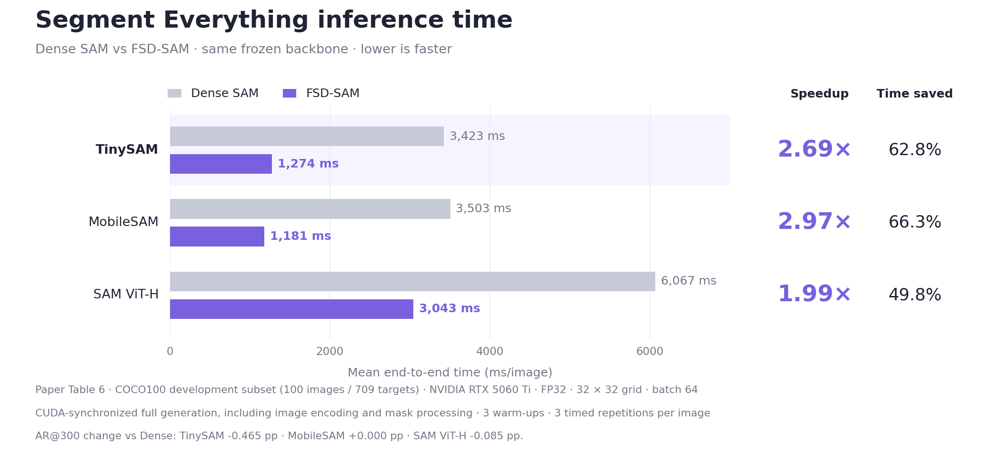

# Mask Refinement and Efficient Automatic Mask Generation for Lightweight SAM

[Project page](https://thirteen7.github.io/Mask-Refinement-and-Efficient-Automatic-Mask-Generation-for-Lightweight-SAM/) · [Interactive demo](https://huggingface.co/spaces/thirteen7/Rethinking-Lightweight-SAM) · [Models](https://github.com/thirteen7/Mask-Refinement-and-Efficient-Automatic-Mask-Generation-for-Lightweight-SAM/releases/tag/v1.0.0) · [Results](docs/results.md) · [中文](README.zh-CN.md)

**Mask refinement** improves point- and box-prompted segmentation. **FSD-SAM** speeds up automatic mask generation by sharing image-dependent computation and completing decoding at selected grid points. Both workflows use frozen SAM backbones.

Use **TinySAM, MobileSAM, or SAM ViT-H**. Each complete checkpoint includes the backbone and six refinement modules: first-click selection, interaction feedback, local residual repair, box selection, an independent box decoder, and an edit comparator.

## Installation

Python 3.10 or later. Install a compatible PyTorch/torchvision build first. Training and dataset evaluation use CUDA; model loading and the interactive API also support CPU.

```bash
git clone https://github.com/thirteen7/Mask-Refinement-and-Efficient-Automatic-Mask-Generation-for-Lightweight-SAM.git
cd Mask-Refinement-and-Efficient-Automatic-Mask-Generation-for-Lightweight-SAM
pip install -r requirements.txt
pip install -e . --no-deps
```

For experimental reproduction, use PyTorch 2.0.0 / torchvision 0.15.1 and keep the hardware, CUDA, and dependency versions fixed.

## Download models

```bash
python download_models.py --model tinysam
# Other options: mobilesam, vith, all
```

Checkpoints are saved to `weights/`. The downloader verifies SHA256 and automatically assembles the ViT-H transport parts into one complete `.pth`. Model hashes are listed in [models.json](models.json).

## Evaluate

```bash
python evaluate.py --model tinysam --checkpoint weights/tinysam_prompt_adaptive_v1.pth --dataset coco --data-root datasets/coco --output runs/tinysam-coco
```

Select `lvis` or `sa1b` with `--dataset`, and choose a GPU with `--gpu 1`. Use `--dry-run` to inspect data coverage or `--max-images 1` for a one-image check.

Evaluation uses ordinary **legacy mIoU**, a mask-center first click, three point/box interaction rounds, and chunks of 64 objects. COCO/LVIS include all valid validation images and non-crowd targets. SA-1B uses the official cap64 reader: sampling without replacement, seeded by the original image index. Ground truth generates initial prompts, simulated corrective clicks, and IoU scores.

Dataset evaluation writes `summary.json`, per-target numerical records, logs, and `verified.json`. Use `generate.py` for mask files and overlays.

```text
datasets/coco/
  annotations/instances_val2017.json
  annotations/lvis_v1_val.json
  val2017/
  train2017/                # Some LVIS validation images come from this split
datasets/sa1b/
  images/val/*.jpg
  annotations/val/*.json
```

A merged `coco/trainval/` image directory is also supported. LVIS evaluation uses `lvis_v1_val.json`, which includes images from both COCO train2017 and val2017.

## Train and export

Fitting, calibration, and checkpoint selection use **SA-1B training data**. The fixed 3,500-image manifest defines disjoint 2,900/300/300 partitions. First-click fitting uses 1,500 images; later decoder/comparator stages use 256/64/32 images.

```bash
python prepare_data.py --source datasets/sa1b --output datasets/sa1b_train3500
python download_models.py --model tinysam --base-only
python train.py --model tinysam --base weights/tinysam_official_base.pth --data-root datasets/sa1b_train3500 --output runs/train-tinysam
```

Training exports `runs/train-tinysam/tinysam_prompt_adaptive_v1.pth` automatically. Replace the model name to train another backbone. The default training decode chunk is 4; `--batch-size` changes the memory requirement.

Use `--reuse-first weights/tinysam_prompt_adaptive_v1.pth` to reuse a first-click module. By default, it is fitted from scratch. `--dry-run` inspects the inputs and prints the training stages.

To export an existing complete set of modules:

```bash
python merge.py --model tinysam --base weights/tinysam_official_base.pth --components runs/train-tinysam --output weights/tinysam_custom.pth
```

## Interactive API

```python
from PIL import Image
import numpy as np
from prompt_adaptive_sam import Predictor

predictor = Predictor("weights/tinysam_prompt_adaptive_v1.pth", device="cuda")
predictor.set_image(np.asarray(Image.open("example.jpg").convert("RGB")))
mask, logits, choice = predictor.predict([[200, 150]], [1])

# Pass the complete click history and the previous logits for correction.
mask, logits, choice = predictor.predict(
    [[200, 150], [250, 180]], [1, 1], previous=logits
)

# Boxes use original-image coordinates: [x0, y0, x1, y1].
mask, logits, choice = predictor.predict(box=[100, 80, 350, 300])
```

## Everything mode

Generate instance masks without supplying points or boxes. **FSD-SAM** uses
factorized prompt state, native previews and selective suffix decoding;
**Dense SAM** completes all sampled requests through the native decoder.

```bash
python generate.py --checkpoint weights/tinysam_prompt_adaptive_v1.pth --image example.jpg --method fsd --grid 32 --output runs/everything
```

The research studio pairs **SAM ViT-H / Dense** with **FSD-SAM / ViT-H**
under the same image, 8/16/32 grid and frozen base, displaying real milliseconds
for each. See the [Everything interface and protocol](docs/everything.md).

## Interactive application

[Code](https://github.com/thirteen7/Mask-Refinement-and-Efficient-Automatic-Mask-Generation-for-Lightweight-SAM) ·
[Live demo](https://huggingface.co/spaces/thirteen7/Rethinking-Lightweight-SAM) ·
[Project page](https://thirteen7.github.io/Mask-Refinement-and-Efficient-Automatic-Mask-Generation-for-Lightweight-SAM/)

Point and Box use curated annotated images with fixed foreground prompts.
Run the initial prompt to compare the original and refined decoder outputs.
Use the sidebar buttons to add the two preset correction points in order.
Previous / Next restores saved images, prompts and target IoU for each stage.
Everything accepts uploads and measures both automatic generation paths.
The FSD animation has playback and step controls.
See the [qualitative comparison protocol](docs/showcase.md).

For the same studio locally:

```bash
pip install -r demo/requirements.txt
SAM_DEMO_DEVICE=cpu python demo/space/app.py
```

On Windows PowerShell, set `$env:SAM_DEMO_DEVICE='cuda'` (or `'cpu'`), then run
`python demo/space/app.py`. Open `http://127.0.0.1:7860`.
See [demo/README.md](demo/README.md) for deployment.

## Results

Interaction results report instance-averaged legacy IoU (%). The initial prompt is a foreground click at the mask center or a ground-truth box; +1/+2 add one or two corrective clicks. Gains use unrounded values. **† Historical baselines:** MobileSAM on SA-11K and SAM ViT-H on LVIS and SA-11K.

### Point prompts: initial and after correction


[Vector figure (SVG)](site/assets/results/point-comparison.svg)

The bars compare the initial prompt; the adjacent columns show gains at all three stages, with the initial stage highlighted. Table values are **Original → Refined**; Δ is the gain at that same stage, in percentage points (pp).

| Dataset / backbone | **Initial IoU (%)** | **Initial Δ (pp)** | +1 click IoU (%) | +1 Δ (pp) | +2 clicks IoU (%) | +2 Δ (pp) |
|---|---:|---:|---:|---:|---:|---:|
| COCO val2017 / TinySAM | 46.77 → **55.65** | **+8.88** | 59.62 → **64.43** | +4.81 | 63.55 → **69.44** | +5.89 |
| COCO val2017 / MobileSAM | 50.89 → **55.00** | **+4.10** | 59.74 → **64.45** | +4.71 | 62.90 → **69.50** | +6.61 |
| COCO val2017 / ViT-H | 53.57 → **60.83** | **+7.26** | 67.26 → **70.47** | +3.21 | 71.69 → **74.80** | +3.11 |
| LVIS v1 val / TinySAM | 53.65 → **56.26** | **+2.61** | 53.31 → **62.70** | +9.40 | 54.51 → **66.32** | +11.82 |
| LVIS v1 val / MobileSAM | 51.41 → **54.43** | **+3.02** | 52.37 → **60.91** | +8.54 | 54.13 → **65.86** | +11.73 |
| LVIS v1 val / ViT-H † | 60.50 → **62.01** | **+1.51** | 68.10 → **68.55** | +0.45 | 70.70 → **72.62** | +1.92 |
| SA-11K / TinySAM | 66.83 → **70.14** | **+3.31** | 75.88 → **76.27** | +0.39 | 78.59 → **78.73** | +0.14 |
| SA-11K / MobileSAM † | 64.60 → **68.21** | **+3.61** | 73.40 → **74.84** | +1.44 | 76.20 → **79.20** | +3.00 |
| SA-11K / ViT-H † | 76.50 → **78.22** | **+1.72** | 83.40 → **84.32** | +0.92 | 85.10 → **86.52** | +1.42 |

### Box prompts: initial and after correction


[Vector figure (SVG)](site/assets/results/box-comparison.svg)

The bars compare the initial prompt; the adjacent columns show gains at all three stages, with the initial stage highlighted. Table values are **Original → Refined**; Δ is the gain at that same stage, in percentage points (pp).

| Dataset / backbone | **Initial IoU (%)** | **Initial Δ (pp)** | +1 click IoU (%) | +1 Δ (pp) | +2 clicks IoU (%) | +2 Δ (pp) |
|---|---:|---:|---:|---:|---:|---:|
| COCO val2017 / TinySAM | 74.99 → **76.52** | **+1.52** | 74.42 → **77.68** | +3.26 | 74.29 → **78.36** | +4.08 |
| COCO val2017 / MobileSAM | 74.45 → **76.03** | **+1.58** | 72.57 → **77.03** | +4.46 | 71.95 → **77.23** | +5.28 |
| COCO val2017 / ViT-H | 77.28 → **78.17** | **+0.89** | 77.76 → **78.56** | +0.80 | 78.00 → **78.70** | +0.70 |
| LVIS v1 val / TinySAM | 73.81 → **75.47** | **+1.66** | 70.37 → **76.57** | +6.20 | 69.29 → **77.13** | +7.84 |
| LVIS v1 val / MobileSAM | 72.81 → **74.45** | **+1.64** | 67.30 → **75.36** | +8.06 | 65.49 → **75.68** | +10.20 |
| LVIS v1 val / ViT-H † | 77.80 → **77.86** | **+0.06** | 78.30 → **78.45** | +0.15 | 78.50 → **78.60** | +0.10 |
| SA-11K / TinySAM | 82.90 → **84.16** | **+1.26** | 83.79 → **84.84** | +1.05 | 84.24 → **85.18** | +0.95 |
| SA-11K / MobileSAM † | 82.00 → **83.50** | **+1.50** | 82.40 → **84.08** | +1.68 | 82.70 → **84.32** | +1.62 |
| SA-11K / ViT-H † | 86.70 → **87.86** | **+1.16** | 86.70 → **88.07** | +1.37 | 87.10 → **88.10** | +1.00 |

### Segment Everything: Dense SAM versus FSD-SAM



[Vector figure (SVG)](site/assets/results/fsd-time-comparison.svg)

| Backbone / policy | ms/image ↓ | Speedup | AR@300 (%) ↑ | ΔAR (pp) |
|---|---:|---:|---:|---:|
| TinySAM / Dense | 3,423 | 1.00× | 15.797 | +0.000 |
| TinySAM / FSD-SAM | 1,274 | 2.69× | 15.331 | -0.465 |
| MobileSAM / Dense | 3,503 | 1.00× | 33.935 | +0.000 |
| MobileSAM / FSD-SAM | 1,181 | 2.97× | 33.935 | +0.000 |
| SAM ViT-H / Dense | 6,067 | 1.00× | 48.322 | +0.000 |
| SAM ViT-H / FSD-SAM | 3,043 | 1.99× | 48.237 | -0.085 |

On COCO100, FSD-SAM speeds up MobileSAM by **2.97×** while matching its Dense AR@300 of **33.935%**. The benchmark uses 100 COCO val2017 images, 709 targets, an NVIDIA RTX 5060 Ti, FP32, a 32 × 32 grid, and 64 prompts per batch. Speedup and ΔAR are relative to Dense on the same backbone.

The [full COCO100 table](docs/results.md#segment-everything-timing) includes Hierarchical, both IoU metrics and completed points.

## License and acknowledgments

[LICENSE](LICENSE) · [NOTICE](NOTICE)

[SAM](https://github.com/facebookresearch/segment-anything) · [TinySAM](https://github.com/xinghaochen/TinySAM) · [MobileSAM](https://github.com/ChaoningZhang/MobileSAM)
