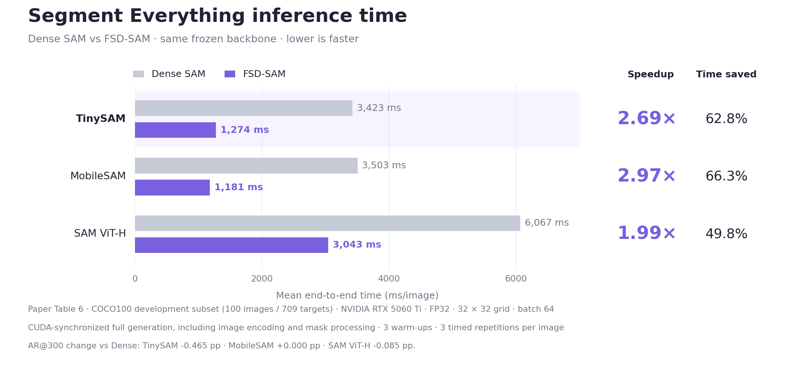

# Mask Refinement and Efficient Automatic Mask Generation for Lightweight SAM

[English](README.md) · [项目主页](https://thirteen7.github.io/Mask-Refinement-and-Efficient-Automatic-Mask-Generation-for-Lightweight-SAM/) · [交互演示](https://huggingface.co/spaces/thirteen7/Rethinking-Lightweight-SAM) · [模型下载](https://github.com/thirteen7/Mask-Refinement-and-Efficient-Automatic-Mask-Generation-for-Lightweight-SAM/releases/tag/v1.0.0)

**掩码精化**提升点提示和框提示的分割质量。**FSD-SAM** 复用与图像相关的计算，并选择部分网格点完成解码，加速自动掩码生成。两条流程都使用冻结的 SAM 骨干。

支持 **TinySAM、MobileSAM、SAM ViT-H**。每份完整 `.pth` 包含官方骨干和六个精化模块：首点选择、交互反馈、局部残差修正、框选择、独立框解码器和编辑比较器。

## 1. 安装

Python 3.10+。先安装匹配的 PyTorch/torchvision；训练和数据集评估需要 CUDA，模型加载及交互 API 支持 CPU。

```bash
git clone https://github.com/thirteen7/Mask-Refinement-and-Efficient-Automatic-Mask-Generation-for-Lightweight-SAM.git
cd Mask-Refinement-and-Efficient-Automatic-Mask-Generation-for-Lightweight-SAM
pip install -r requirements.txt
pip install -e . --no-deps
```

复现实验时使用 PyTorch 2.0.0 / torchvision 0.15.1，并固定 CUDA、硬件与依赖版本。

## 2. 下载一份模型

```bash
python download_models.py --model tinysam
# 其它模型：--model mobilesam / vith；全部：--model all
```

文件保存在 `weights/`。下载器自动拼接 ViT-H 分片并校验完整 `.pth` 的 SHA256。模型与分片的哈希见 [models.json](models.json)。

## 3. 评估

```bash
python evaluate.py --model tinysam --checkpoint weights/tinysam_prompt_adaptive_v1.pth --dataset coco --data-root datasets/coco --output runs/tinysam-coco
```

用 `--dataset lvis` 或 `--dataset sa1b` 切换数据集，用 `--gpu 1` 选择显卡。`--dry-run` 检查数据覆盖，`--max-images 1` 运行单图检查。

协议：采用 **legacy mIoU**，首点位于目标掩码中心，点／框各三轮，每块 64 个目标。COCO/LVIS 使用所有有效验证图和非 crowd 目标。SA-1B 使用官方读取器，每图最多采样 64 个目标，以原图索引为随机种子进行无放回抽样。真实标注用于生成初始提示、模拟纠错和评分。

评估输出包括 `summary.json`、逐目标数值、日志和 `verified.json`。导出掩码和叠加图可用 `generate.py`。

数据布局：

```text
datasets/coco/
  annotations/instances_val2017.json
  annotations/lvis_v1_val.json
  val2017/                  # COCO 验证图
  train2017/                # LVIS 验证也使用部分 COCO train2017 图
datasets/sa1b/
  images/val/*.jpg
  annotations/val/*.json
```

也可使用合并图像目录 `coco/trainval/`。LVIS 的 `lvis_v1_val.json` 包含 COCO train2017 和 val2017 图像。

## 4. 训练并自动合并

拟合、校准和权重选择使用 **SA-1B 训练集**。固定的 3500 张图像划分为互不重叠的 2900／300／300 张。首点模块用 1500 张图像拟合；后续解码器和比较器阶段使用 256／64／32 张。

```bash
python prepare_data.py --source datasets/sa1b --output datasets/sa1b_train3500
python download_models.py --model tinysam --base-only
python train.py --model tinysam --base weights/tinysam_official_base.pth --data-root datasets/sa1b_train3500 --output runs/train-tinysam
```

训练完成后自动生成 `runs/train-tinysam/tinysam_prompt_adaptive_v1.pth`。更换模型名即可使用其它骨干。默认训练解码分块为 4；可用 `--batch-size` 调整资源需求，复现时保持协议相同。

添加 `--reuse-first weights/tinysam_prompt_adaptive_v1.pth` 可复用首点头；默认从头训练首点头。`--dry-run` 检查训练输入并打印阶段。

已有完整模块训练目录可单独合并：

```bash
python merge.py --model tinysam --base weights/tinysam_official_base.pth --components runs/train-tinysam --output weights/tinysam_custom.pth
```

## 5. 交互调用

```python
from PIL import Image
import numpy as np
from prompt_adaptive_sam import Predictor

predictor = Predictor("weights/tinysam_prompt_adaptive_v1.pth", device="cuda")
predictor.set_image(np.asarray(Image.open("example.jpg").convert("RGB")))
mask, logits, choice = predictor.predict([[200, 150]], [1])
# 后续点击需传入完整历史，并传入上轮 logits。
mask, logits, choice = predictor.predict([[200, 150], [250, 180]], [1, 1], previous=logits)
# 框使用原图坐标 [x0, y0, x1, y1]。
mask, logits, choice = predictor.predict(box=[100, 80, 350, 300])
```

## Everything 整图分割

无需手动添加点或框，即可自动生成实例掩码。支持 FSD-SAM 的因子化状态、
原生预览和选择性后缀解码，以及 Dense SAM 的完整网格解码。

```bash
python generate.py --checkpoint weights/tinysam_prompt_adaptive_v1.pth --image example.jpg --method fsd --grid 32 --output runs/everything
```

工作台提供 Point、Box、Everything 三种模式。点／框模式提供四个带标注的精选样例。先运行初始提示，再逐次加入两个预设前景纠错点。每个阶段并排显示原版与精化结果以及目标 IoU；用上一结果／下一结果回看各轮。

Everything 支持上传图片。一次运行即可比较左侧 SAM ViT-H / Dense 和右侧 FSD-SAM / ViT-H 的掩码与实测耗时。**How FSD works** 展示网格点筛选和掩码生成流程。

[代码](https://github.com/thirteen7/Mask-Refinement-and-Efficient-Automatic-Mask-Generation-for-Lightweight-SAM) · [在线 Demo](https://huggingface.co/spaces/thirteen7/Rethinking-Lightweight-SAM) · [项目网页](https://thirteen7.github.io/Mask-Refinement-and-Efficient-Automatic-Mask-Generation-for-Lightweight-SAM/)

本地 PowerShell 运行：

```powershell
pip install -r demo/requirements.txt
$env:SAM_DEMO_DEVICE='cuda'  # 无 CUDA 时使用 cpu
python demo/space/app.py
```

打开 `http://127.0.0.1:7860`。详见 [展示对比协议](docs/showcase.md)、[Everything 协议](docs/everything.md) 和 [部署说明](demo/README.md)。

## 实验结果

交互结果报告逐实例平均 legacy IoU（%）。初始提示为掩码中心的前景点或真实标注框；+1／+2 表示累计添加一／两次纠错点击。增益以未舍入数值计算。**† 历史基线：** SA-11K 的 MobileSAM，以及 LVIS 和 SA-11K 的 SAM ViT-H。

### 点提示：初始与纠错后


[矢量图 (SVG)](site/assets/results/point-comparison.svg)

左侧柱状图突出初始提示的原版／改进对比；右侧列出首点或初始框、+1 点、+2 点的提升，初始列加框突出。表内数值依次为 **原版 → 改进**；pp 表示百分点，每个差值对应同一提示阶段。

| 数据集 / 骨干 | **首点 IoU (%)** | **首点提升 (pp)** | +1 点 IoU (%) | +1 点提升 (pp) | +2 点 IoU (%) | +2 点提升 (pp) |
|---|---:|---:|---:|---:|---:|---:|
| COCO val2017 / TinySAM | 46.77 → **55.65** | **+8.88** | 59.62 → **64.43** | +4.81 | 63.55 → **69.44** | +5.89 |
| COCO val2017 / MobileSAM | 50.89 → **55.00** | **+4.10** | 59.74 → **64.45** | +4.71 | 62.90 → **69.50** | +6.61 |
| COCO val2017 / ViT-H | 53.57 → **60.83** | **+7.26** | 67.26 → **70.47** | +3.21 | 71.69 → **74.80** | +3.11 |
| LVIS v1 val / TinySAM | 53.65 → **56.26** | **+2.61** | 53.31 → **62.70** | +9.40 | 54.51 → **66.32** | +11.82 |
| LVIS v1 val / MobileSAM | 51.41 → **54.43** | **+3.02** | 52.37 → **60.91** | +8.54 | 54.13 → **65.86** | +11.73 |
| LVIS v1 val / ViT-H † | 60.50 → **62.01** | **+1.51** | 68.10 → **68.55** | +0.45 | 70.70 → **72.62** | +1.92 |
| SA-11K / TinySAM | 66.83 → **70.14** | **+3.31** | 75.88 → **76.27** | +0.39 | 78.59 → **78.73** | +0.14 |
| SA-11K / MobileSAM † | 64.60 → **68.21** | **+3.61** | 73.40 → **74.84** | +1.44 | 76.20 → **79.20** | +3.00 |
| SA-11K / ViT-H † | 76.50 → **78.22** | **+1.72** | 83.40 → **84.32** | +0.92 | 85.10 → **86.52** | +1.42 |

### 框提示：初始与纠错后


[矢量图 (SVG)](site/assets/results/box-comparison.svg)

左侧柱状图突出初始提示的原版／改进对比；右侧列出首点或初始框、+1 点、+2 点的提升，初始列加框突出。表内数值依次为 **原版 → 改进**；pp 表示百分点，每个差值对应同一提示阶段。

| 数据集 / 骨干 | **初始框 IoU (%)** | **初始框提升 (pp)** | +1 点 IoU (%) | +1 点提升 (pp) | +2 点 IoU (%) | +2 点提升 (pp) |
|---|---:|---:|---:|---:|---:|---:|
| COCO val2017 / TinySAM | 74.99 → **76.52** | **+1.52** | 74.42 → **77.68** | +3.26 | 74.29 → **78.36** | +4.08 |
| COCO val2017 / MobileSAM | 74.45 → **76.03** | **+1.58** | 72.57 → **77.03** | +4.46 | 71.95 → **77.23** | +5.28 |
| COCO val2017 / ViT-H | 77.28 → **78.17** | **+0.89** | 77.76 → **78.56** | +0.80 | 78.00 → **78.70** | +0.70 |
| LVIS v1 val / TinySAM | 73.81 → **75.47** | **+1.66** | 70.37 → **76.57** | +6.20 | 69.29 → **77.13** | +7.84 |
| LVIS v1 val / MobileSAM | 72.81 → **74.45** | **+1.64** | 67.30 → **75.36** | +8.06 | 65.49 → **75.68** | +10.20 |
| LVIS v1 val / ViT-H † | 77.80 → **77.86** | **+0.06** | 78.30 → **78.45** | +0.15 | 78.50 → **78.60** | +0.10 |
| SA-11K / TinySAM | 82.90 → **84.16** | **+1.26** | 83.79 → **84.84** | +1.05 | 84.24 → **85.18** | +0.95 |
| SA-11K / MobileSAM † | 82.00 → **83.50** | **+1.50** | 82.40 → **84.08** | +1.68 | 82.70 → **84.32** | +1.62 |
| SA-11K / ViT-H † | 86.70 → **87.86** | **+1.16** | 86.70 → **88.07** | +1.37 | 87.10 → **88.10** | +1.00 |

### Segment Everything：Dense SAM 与 FSD-SAM 时间对比



[矢量图 (SVG)](site/assets/results/fsd-time-comparison.svg)

| 骨干 / 策略 | ms/图 ↓ | 加速比 | AR@300 (%) ↑ | ΔAR (pp) |
|---|---:|---:|---:|---:|
| TinySAM / Dense | 3,423 | 1.00× | 15.797 | +0.000 |
| TinySAM / FSD-SAM | 1,274 | 2.69× | 15.331 | -0.465 |
| MobileSAM / Dense | 3,503 | 1.00× | 33.935 | +0.000 |
| MobileSAM / FSD-SAM | 1,181 | 2.97× | 33.935 | +0.000 |
| SAM ViT-H / Dense | 6,067 | 1.00× | 48.322 | +0.000 |
| SAM ViT-H / FSD-SAM | 3,043 | 1.99× | 48.237 | -0.085 |

在 COCO100 上，FSD-SAM 将 MobileSAM 加速至 **2.97×**，AR@300 与 Dense 同为 **33.935%**。该评估使用 100 张 COCO val2017 图像、709 个目标、NVIDIA RTX 5060 Ti、FP32、32 × 32 网格和每批 64 个提示。加速比和 ΔAR 以同一骨干的 Dense 为基准。[完整结果](docs/results.md#segment-everything-timing)还包括 Hierarchical、两项 IoU 指标和完成解码的平均点数。

## 许可与致谢

许可文件：[LICENSE](LICENSE)、[NOTICE](NOTICE)。

致谢：[SAM](https://github.com/facebookresearch/segment-anything)、[TinySAM](https://github.com/xinghaochen/TinySAM)、[MobileSAM](https://github.com/ChaoningZhang/MobileSAM)。
