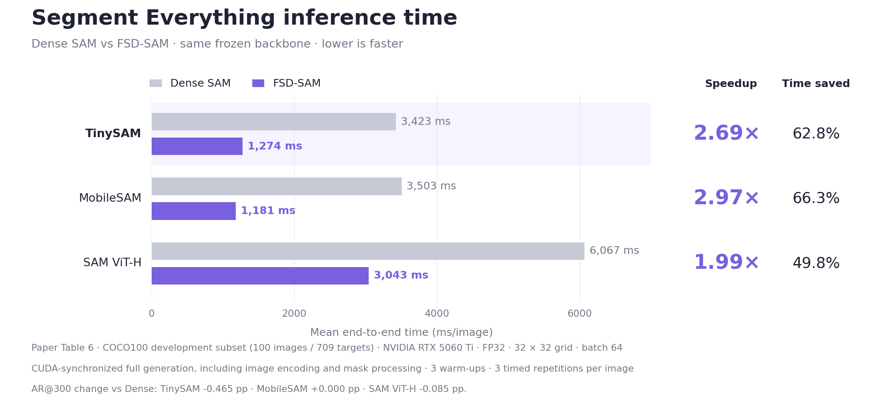

# Evaluation results

Interaction results report instance-averaged legacy IoU (%). The initial prompt is a foreground click at the mask center or a ground-truth box; +1/+2 add one or two corrective clicks. Gains use unrounded values. **† Historical baselines:** MobileSAM on SA-11K and SAM ViT-H on LVIS and SA-11K.

Fitting, calibration and checkpoint selection use SA-1B training data. COCO covers 4,952 annotated images / 36,335 targets; LVIS covers 19,626 valid images / 244,707 targets. The SA-11K cap64 evaluation covers 11,186 images / 618,098 targets.

## Point prompts

[Vector figure (SVG)](../site/assets/results/point-comparison.svg)

The bars compare the initial prompt; the adjacent columns show gains at all three stages, with the initial stage highlighted. Table values are **Original → Refined**; Δ is the gain at that same stage, in percentage points (pp).

| Dataset / backbone | **Initial IoU (%)** | **Initial Δ (pp)** | +1 click IoU (%) | +1 Δ (pp) | +2 clicks IoU (%) | +2 Δ (pp) |
|---|---:|---:|---:|---:|---:|---:|
| COCO val2017 / TinySAM | 46.77 → **55.65** | **+8.88** | 59.62 → **64.43** | +4.81 | 63.55 → **69.44** | +5.89 |
| COCO val2017 / MobileSAM | 50.89 → **55.00** | **+4.10** | 59.74 → **64.45** | +4.71 | 62.90 → **69.50** | +6.61 |
| COCO val2017 / ViT-H | 53.57 → **60.83** | **+7.26** | 67.26 → **70.47** | +3.21 | 71.69 → **74.80** | +3.11 |
| LVIS v1 val / TinySAM | 53.65 → **56.26** | **+2.61** | 53.31 → **62.70** | +9.40 | 54.51 → **66.32** | +11.82 |
| LVIS v1 val / MobileSAM | 51.41 → **54.43** | **+3.02** | 52.37 → **60.91** | +8.54 | 54.13 → **65.86** | +11.73 |
| LVIS v1 val / ViT-H † | 60.50 → **62.01** | **+1.51** | 68.10 → **68.55** | +0.45 | 70.70 → **72.62** | +1.92 |
| SA-11K / TinySAM | 66.83 → **70.14** | **+3.31** | 75.88 → **76.27** | +0.39 | 78.59 → **78.73** | +0.14 |
| SA-11K / MobileSAM † | 64.60 → **68.21** | **+3.61** | 73.40 → **74.84** | +1.44 | 76.20 → **79.20** | +3.00 |
| SA-11K / ViT-H † | 76.50 → **78.22** | **+1.72** | 83.40 → **84.32** | +0.92 | 85.10 → **86.52** | +1.42 |

## Box prompts

[Vector figure (SVG)](../site/assets/results/box-comparison.svg)

The bars compare the initial prompt; the adjacent columns show gains at all three stages, with the initial stage highlighted. Table values are **Original → Refined**; Δ is the gain at that same stage, in percentage points (pp).

| Dataset / backbone | **Initial IoU (%)** | **Initial Δ (pp)** | +1 click IoU (%) | +1 Δ (pp) | +2 clicks IoU (%) | +2 Δ (pp) |
|---|---:|---:|---:|---:|---:|---:|
| COCO val2017 / TinySAM | 74.99 → **76.52** | **+1.52** | 74.42 → **77.68** | +3.26 | 74.29 → **78.36** | +4.08 |
| COCO val2017 / MobileSAM | 74.45 → **76.03** | **+1.58** | 72.57 → **77.03** | +4.46 | 71.95 → **77.23** | +5.28 |
| COCO val2017 / ViT-H | 77.28 → **78.17** | **+0.89** | 77.76 → **78.56** | +0.80 | 78.00 → **78.70** | +0.70 |
| LVIS v1 val / TinySAM | 73.81 → **75.47** | **+1.66** | 70.37 → **76.57** | +6.20 | 69.29 → **77.13** | +7.84 |
| LVIS v1 val / MobileSAM | 72.81 → **74.45** | **+1.64** | 67.30 → **75.36** | +8.06 | 65.49 → **75.68** | +10.20 |
| LVIS v1 val / ViT-H † | 77.80 → **77.86** | **+0.06** | 78.30 → **78.45** | +0.15 | 78.50 → **78.60** | +0.10 |
| SA-11K / TinySAM | 82.90 → **84.16** | **+1.26** | 83.79 → **84.84** | +1.05 | 84.24 → **85.18** | +0.95 |
| SA-11K / MobileSAM † | 82.00 → **83.50** | **+1.50** | 82.40 → **84.08** | +1.68 | 82.70 → **84.32** | +1.62 |
| SA-11K / ViT-H † | 86.70 → **87.86** | **+1.16** | 86.70 → **88.07** | +1.37 | 87.10 → **88.10** | +1.00 |

## Segment Everything timing

[Vector figure (SVG)](../site/assets/results/fsd-time-comparison.svg)

| Backbone / method | ms/image | Speedup | AR@300 (%) | ΔAR (pp) | Best IoU (%) | 1-to-1 IoU (%) | Points completed |
|---|---:|---:|---:|---:|---:|---:|---:|
| TinySAM / Dense | 3,423 | 1.00× | 15.797 | +0.000 | 29.550 | 28.877 | 1024.0 |
| TinySAM / Hierarchical | 1,808 | 1.89× | 16.164 | +0.367 | 29.804 | 29.135 | 618.1 |
| TinySAM / FSD-SAM | 1,274 | 2.69× | 15.331 | -0.465 | 29.063 | 28.382 | 417.1 |
| MobileSAM / Dense | 3,503 | 1.00× | 33.935 | +0.000 | 49.108 | 48.253 | 1024.0 |
| MobileSAM / Hierarchical | 1,510 | 2.32× | 33.230 | -0.705 | 48.479 | 47.458 | 495.5 |
| MobileSAM / FSD-SAM | 1,181 | 2.97× | 33.935 | +0.000 | 49.122 | 48.231 | 312.3 |
| SAM ViT-H / Dense | 6,067 | 1.00× | 48.322 | +0.000 | 62.198 | 61.749 | 1024.0 |
| SAM ViT-H / Hierarchical | 2,966 | 2.05× | 46.093 | -2.228 | 60.189 | 59.607 | 381.5 |
| SAM ViT-H / FSD-SAM | 3,043 | 1.99× | 48.237 | -0.085 | 62.043 | 61.561 | 352.4 |

COCO100 uses the 100 COCO val2017 images with the smallest IDs and 709 non-crowd instances. NVIDIA RTX 5060 Ti, FP32, 32 × 32 grid, 64 prompts/batch. Speedup and ΔAR are relative to Dense on the same backbone and use unrounded values. Three warm-up passes precede three timed runs per image; the first timed run supplies the quality metrics. CUDA-synchronized timing starts at image encoding and ends after mask filtering, NMS and run-length encoding.

## Source

[Machine-readable interaction results](../site/benchmarks.json) · [Machine-readable COCO100 results](../site/paper-everything.json) · [Gallery annotations and per-image IoU](showcase.md).

The PNG and SVG figures are generated from `site/benchmarks.json` (interaction) and `site/paper-everything.json` (timing). With matplotlib installed, run `python docs/figures/plot_prompt_results.py` or `python docs/figures/plot_everything_time.py`. The interaction figures share a 0–100 IoU axis and 0–12 pp gain color scale; the timing figure starts at 0 ms.

## TinySAM LVIS data correction

For image 195271, annotation 94187, a targeted replay replaced the stored
second-round point IoU of 1.2310324907302856 with 0.9289711713790894. CPU and GPU
agree on intersection 2158 and union 2323. The replay used the same frozen model
and previous-image RNG state and reproduced the other 134 point IoUs, all 135
candidate choices and the final point RNG state. The corrected ledger passed CPU
coverage, range, order and reaggregation checks. The original ledger and cache
preserve the out-of-range entry; its cause remains undetermined.

## TinySAM COCO1000 structure ablation

The ablation compares module configurations on 1,000 fixed validation images
and 7,179 targets. Each gain uses the same-host control for the configuration.

| Prompt / configuration | Round 1 | Round 2 | Round 3 |
|---|---:|---:|---:|
| Point / native, server control | 46.466 | 63.487 | 68.789 |
| Point / first-click selector | 55.798 | 61.478 | 68.082 |
| Point / first + feedback | 55.798 | 62.631 | 67.677 |
| Point / first + residual | 55.798 | 63.027 | 69.087 |
| Point / full | 55.798 | 64.473 | 69.556 |
| Box / native | 75.095 | 76.425 | 77.054 |
| Box / current selector | 75.221 | 76.497 | 77.275 |
| Box / independent decoder | 76.411 | 77.880 | 78.545 |
| Box / full | 76.601 | 77.915 | 78.549 |

The full point configuration reaches 69.556 IoU at round 3, compared with
61.677 for first-click selection plus feedback. For box prompts, the full
trajectory gains 0.003 pp over the independent decoder at round 3. Within the
full model’s candidate pool, region selection scores 0.027 pp below
independent-native selection.
